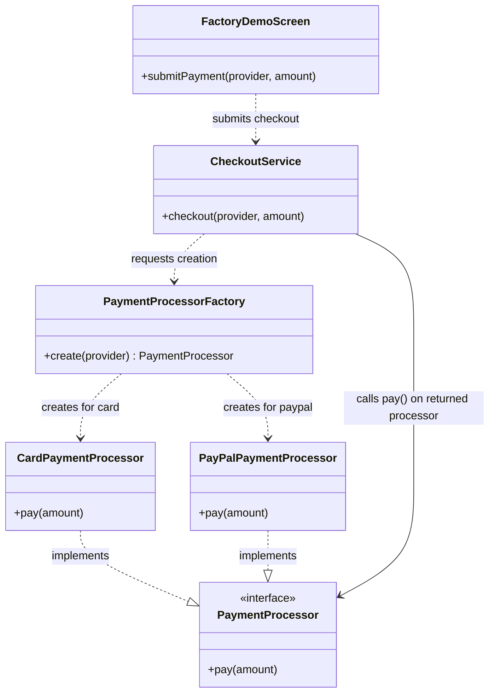
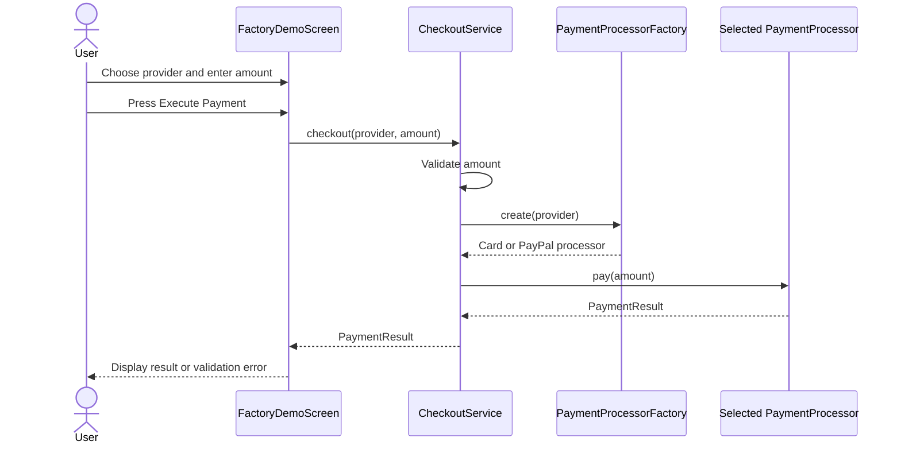

# Simple Factory — Checkout and Payment Processing

## Overview

**Simple Factory** is an object-creation idiom: it centralizes the decision about which concrete object to create and
returns that object through a shared abstraction.

> **Important:** Simple Factory is **not one of the 23 classic Gang of Four (GoF) design patterns**. It is a widely used
> programming idiom often taught alongside creational patterns because it addresses object creation. In contrast,
> Factory Method and Abstract Factory are GoF creational design patterns.

This example applies Simple Factory to a checkout flow. The user chooses a payment provider, the factory creates the
matching payment processor, and the checkout service invokes it through the `PaymentProcessor` interface. The
interactive demo simulates payments; it does not connect to a payment gateway or move money.

## The Problem Without a Factory

Suppose the checkout service chooses and constructs payment processors itself:

```ts
class CheckoutService {
    async checkout(provider: PaymentProvider, amount: number) {
        if (provider === 'card') {
            const processor = new CardPaymentProcessor();
            return processor.pay(amount);
        }

        if (provider === 'paypal') {
            const processor = new PayPalPaymentProcessor();
            return processor.pay(amount);
        }

        throw new Error(`Unsupported payment provider: ${provider}`);
    }
}
```

This works for a small example, but it combines two separate responsibilities:

- Coordinating the checkout operation.
- Deciding which concrete processor to construct.

As more providers are added, the checkout service accumulates construction branches and direct references to concrete
classes. That can make the service harder to read, change, and test in isolation.

The issue is not that conditionals are inherently bad. A conditional is appropriate when it expresses a real decision.
The issue is where that decision belongs when object construction is repeated or distracts from the service's main job.

## The Simple Factory Solution

Move the construction decision to one focused class. The checkout service asks for a processor, then works with the
`PaymentProcessor` abstraction:

```text
CheckoutService
      |
      | create(provider)
      v
PaymentProcessorFactory
      |
      | returns PaymentProcessor
      v
CardPaymentProcessor or PayPalPaymentProcessor
```

The client does not need to construct the concrete processor itself. It receives an object with the expected contract
and delegates the payment operation to it.

## How This Example Works

1. [`FactoryDemoScreen.tsx`](../../demo/FactoryDemoScreen.tsx) passes the selected provider and amount to
   [`CheckoutService.ts`](Services/CheckoutService.ts).
2. The checkout service validates the amount and asks
   [`PaymentProcessorFactory.ts`](factories/PaymentProcessorFactory.ts) to create a processor.
3. The factory selects a concrete processor using the `PaymentProvider` type and returns it as a
   [`PaymentProcessor`](domain/PaymentProcessor.ts).
4. The checkout service calls `pay()` through that interface and returns the resulting
   [`PaymentResult`](domain/PaymentResult.ts) to the screen.

[`CardPaymentProcessor.ts`](processors/CardPaymentProcessor.ts) and
[`PaypalPaymentProcessor.ts`](processors/PaypalPaymentProcessor.ts) implement the same contract, so the checkout
service does not need to know which concrete processor it received.


This keeps the responsibilities easy to identify:

| Component                                         | Responsibility                                 |
|---------------------------------------------------|------------------------------------------------|
| `CheckoutService`                                 | Validates the amount and coordinates checkout  |
| `PaymentProcessorFactory`                         | Chooses and constructs a processor             |
| `PaymentProcessor`                                | Defines the operation the client can rely on   |
| `CardPaymentProcessor` / `PayPalPaymentProcessor` | Implement provider-specific simulated behavior |
| `FactoryDemoScreen`                               | Collects UI input and displays the result      |


## UML Class Diagram



Read the diagram in two parts:

- **Creation:** `CheckoutService` asks `PaymentProcessorFactory` for a processor. The factory chooses and creates the
  concrete class based on the provider.
- **Use:** Both concrete processors implement `PaymentProcessor`, so the checkout service can call `pay()` without
  depending on either concrete class.

The factory depends on the concrete classes because it must instantiate them. The checkout service depends on the
shared interface for payment execution.

## Runtime Flow



For example, selecting `paypal` causes the factory to return a `PayPalPaymentProcessor`. The checkout service then calls
`pay()` on that processor without needing a provider-specific branch of its own.

## What the Factory Does—and Does Not Do

The factory:

- Centralizes a construction choice in one location.
- Hides concrete constructors from the caller that uses the result.
- Returns the result through the stable `PaymentProcessor` interface.
- Makes it straightforward to see which implementations are available.

The factory does **not**:

- Make concrete dependencies disappear; the factory itself imports and constructs them.
- Automatically implement the Dependency Inversion Principle throughout the application.
- Make adding another provider require no changes; this switch and the provider type must be updated.
- Turn the checkout service into a GoF Factory Method pattern. Factory Method uses a creator hierarchy and an
  overridable creation method; this example uses a direct factory class with a selection branch.

## Benefits and Trade-offs

### Benefits

- **Clearer responsibilities:** Checkout coordination is separate from object construction.
- **One place to update:** Provider-to-processor mapping is visible in the factory.
- **Simpler client code:** Callers ask for a processor rather than creating concrete processors themselves.
- **Common interface:** The checkout service uses the same `pay()` contract for all providers.
- **Focused changes:** Provider construction details are localized rather than repeated across clients.

### Trade-offs

- **Factory changes as options grow:** Adding a provider requires updating the provider type and factory selection.
- **Concrete dependencies remain:** The factory still knows every concrete processor it creates.
- **Can become a large switch:** A factory with many unrelated choices may become difficult to maintain.
- **May be unnecessary:** If there is only one implementation and construction is simple, a separate factory can add
  indirection without value.

## Simple Factory vs. Related Patterns

| Approach         | Main purpose                                          | Typical mechanism                                   | GoF design pattern? |
|------------------|-------------------------------------------------------|-----------------------------------------------------|---------------------|
| Simple Factory   | Centralize a choice of concrete object                | A factory method or function with selection logic   | No; it is an idiom  |
| Factory Method   | Let creator subclasses choose which product to create | Inheritance and an overridable creation method      | Yes                 |
| Abstract Factory | Create families of related products                   | An interface with multiple product-creation methods | Yes                 |

Simple Factory is about **which object to construct**. It is separate from Strategy, which is about **which behavior or
algorithm to execute**. This demo creates a processor; that processor performs the payment operation.

## When to Use Simple Factory

Use a Simple Factory when:

- Multiple clients would otherwise repeat the same construction decision.
- A small, finite set of product types is selected by an input or configuration.
- You want to keep object creation out of the main business workflow.
- A direct factory is simpler than a creator hierarchy or plugin system.

Avoid adding one when:

- There is only one straightforward constructor call.
- The factory would only rename a constructor without hiding a meaningful decision.
- The selection logic is likely to grow into a large, frequently changing registry; consider a different composition
  approach if that complexity appears.

## Key Takeaways

- Simple Factory centralizes object construction and returns an object through a shared contract.
- It is a useful creational idiom, but **not a GoF design pattern**.
- The factory knows concrete classes; its clients can depend on the product interface instead.
- The factory reduces duplicated construction decisions, but adding options still changes the factory.
- Choose it when it makes object creation easier to understand—not just to add another abstraction.
